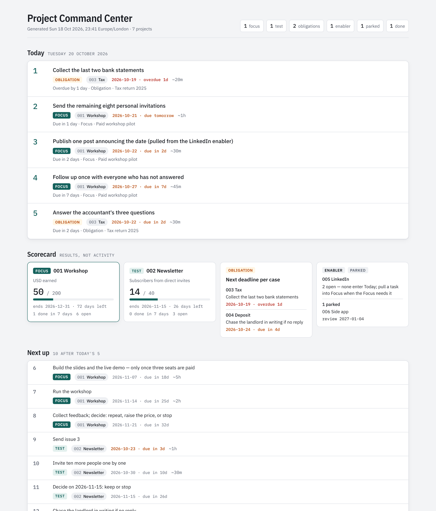

Focus Lanes — run many projects from one folder of Markdown files.

**Let a fixed rule, not your mood, pick at most five tasks for the day.**

A small system for people who juggle several ventures, side projects and obligations across many separate Claude
sessions (Claude Code, Cowork, or both). Every project keeps a `STATUS.md`. A Python script reads them all, applies a
**lane rule**, and writes a daily list, a results scorecard and a dashboard page. A Claude plugin keeps the files up to
date at the end of every session, so the next session — in any tool — starts where the last one stopped.



## Why

Juggling many projects usually fails in one of two ways: every project feels urgent, so the day goes to whichever
one is loudest; or the plan lives in your head and in old chat windows, so every session starts by re-explaining.
This system answers both:

- **One Focus.** Every open project sits in one lane, and only one project can be the Focus. The lane decides how
  much attention a project gets — not how interesting it feels today.
- **Results, not activity.** The Focus and the Test each carry one metric (`current / target`). The scorecard shows
  whether the week moved it.
- **Files are the memory.** Five small Markdown files per project are the only handoff between sessions. Nothing
  depends on a chat history.
- **Generated views only.** Every dashboard is rebuilt from the files. Nothing is maintained by hand, so nothing drifts.

## The lane rule

| Lane | How many | What it gets |
|---|---|---|
| **Focus** | exactly 1 | The thing you are building now. Your best hours. Carries a metric and a target. |
| **Test** | 0–1 | A time-boxed experiment (~2 h/week) with an end date and a pass rule. |
| **Obligation** | any | Things on someone else's clock: tax, a dispute, admin. Surface only when a deadline is close. |
| **Enabler** | any | Serves the Focus (e.g. a social profile). Never enters Today on its own. |
| **Parked** | any | Silent until its review date. |

**Today** = up to **3** Focus tasks + Obligation tasks overdue or due within **3** days, never more than **5**.
**Next up** (10) follows lane order, then date. Everything else is the **Backlog**. Flags call out what needs a
decision: no Focus, two Focus projects, a Test past its end date, a Focus with nothing done in a week, a parked
project whose review date has come. Full detail: [docs/how-it-works.md](docs/how-it-works.md).

## What's in the box

| Path | What it is |
|---|---|
| `plugins/focus-lanes/` | The Claude plugin: three skills and the workspace files they install |
| `…/skills/setup` | Creates a workspace in a folder you choose and sets up your first projects |
| `…/skills/project-status` | Updates a project's files at the end of every session; sets up new projects |
| `…/skills/daily-brief` | Runs the build, reports Today and the scorecard, optionally publishes the page |
| `…/workspace/` | The workspace itself: root `CLAUDE.md` (rules) and `00 Command Center/` (build script, page template, Obsidian dashboard, templates, memory hub, playbooks) |
| `examples/demo-workspace/` | Seven fictional projects, one per lane, to try the build |
| `docs/` | How it works, daily use, Obsidian, scheduling, customising |
| `tests/` | A standard-library test of the lane rule |

## Install

### With Claude Code (plugin)

```bash
claude plugin marketplace add Agent-47x/focus-lanes
claude plugin install focus-lanes@focus-lanes
```

Then, in a Claude Code session opened in the folder you want to use for your projects:

```
/focus-lanes:setup
```

It copies the workspace files, asks for your time zone and house rules, helps you pick your Focus, and runs the first
build.

### With Cowork

Cowork also runs plugins: install this one through your Cowork app's plugin settings (from this marketplace, or from
a zip of `plugins/focus-lanes`), connect your projects folder, and ask Claude to "set up Focus
Lanes". The same three skills apply.

### Without the plugin

Copy everything inside `plugins/focus-lanes/workspace/` into your projects folder and run:

```bash
python "00 Command Center/build_dashboard.py" "/path/to/your/projects" --tz Europe/London
```

Open `00 Command Center/dashboard.html` in a browser. The skills are optional: any Claude session that reads the
root `CLAUDE.md` follows the same rules.

**Requirements:** Python 3.9+ (standard library only). On Windows, named time zones need `pip install tzdata`;
without it the script uses your computer's local time. Optional: [Obsidian](https://obsidian.md) with the Dataview
community plugin for a live in-vault dashboard.

## Try the demo first

```bash
python "plugins/focus-lanes/workspace/00 Command Center/build_dashboard.py" examples/demo-workspace \
  --out examples/demo-workspace/_out \
  --template "plugins/focus-lanes/workspace/00 Command Center/dashboard-template.html" \
  --today 2026-10-20 --no-playbooks
```

Open `examples/demo-workspace/_out/dashboard.html`. That reproduces the screenshot above.

## Daily use, in one paragraph

Work on a project in its own session; at the end, Claude updates its `STATUS.md`, `LOG.md` and `MEMORY.md` (say
"update status" if it forgets). Once a day — by hand ("run the daily brief") or on a schedule — the build regenerates
Today, the scorecard and the page. On Fridays, read the scorecard and change one thing. New idea? It goes in a new
numbered folder in the **Parked** lane with a review date; the Focus changes only when you decide. More:
[docs/daily-use.md](docs/daily-use.md).

## Privacy

Everything stays in your folder. The build reads and writes local files only and makes no network calls. The
dashboard page is published only if you ask Claude to publish it, and it shows `STATUS.md` content only — never
memory, logs or playbooks. Do not put secrets in any of these files; the rules tell Claude never to.

## Support

Provided as-is, under the MIT licence. Issues and pull requests are welcome, but there is no promise of a response
time. Tested with Python 3.13 on Linux; needs 3.9 or later.

## Licence

MIT — see [LICENSE](LICENSE).
